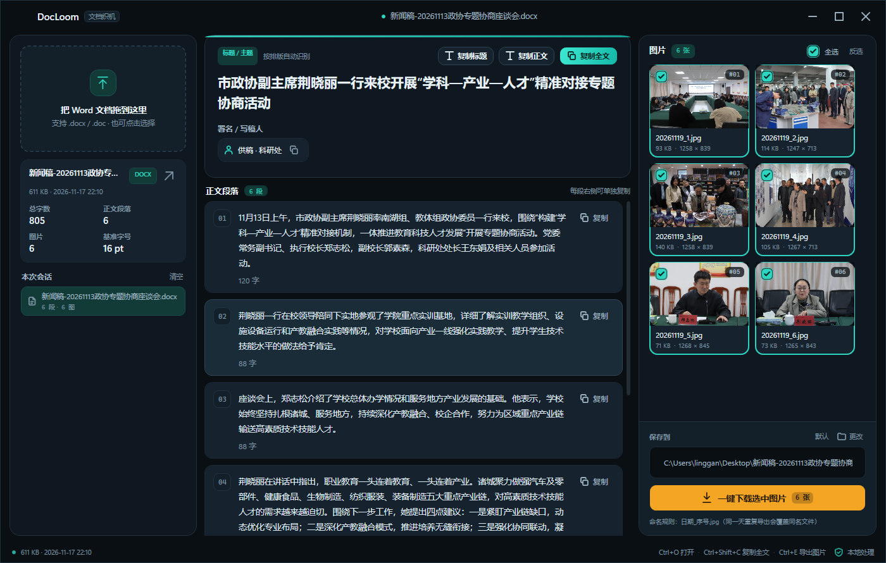

# DocLoom · 文档织机

把 Word 文档拆成 **标题 / 正文段落 / 署名 / 图片** 的 Windows 桌面工具。拖进去 → 自动拆分 → 一键复制、一键下载图片。全程本地处理，不联网。



## 它解决什么

写稿、改稿、排版时常要做这些重复动作：把标题单独摘出来、把正文按自然段拆开、找到文末的「撰稿：某某」、把配图一张张另存。DocLoom 把这一整套动作变成一次拖拽：

- **标题（主题）**：按字号、居中、粗体、大纲级别、样式名的组合判定，多行标题自动合并，`——` 开头的行识别为副标题。
- **正文段落**：按自然段拆分，每段独立显示字数与「含图」标记，右侧一个复制按钮。
- **署名（写稿人）**：识别文末 `撰稿：`、`供稿：`、`文：`、`摄影：` 等标注，自动拆成「部门 + 姓名」并去重。
- **图注**：识别 `（座谈会全景）`、`（参观照片两张）` 这类图片位置提示，回填到相邻图片。
- **图片**：抽取文档内全部图片，缩略图墙里勾选，一键导出到 **桌面 / 文档同名文件夹**，命名为 `20261117_1.jpg`。

顶部还提供 `复制标题`、`复制正文`、`复制全文`，以及 `打开原文档`。

## 界面

Dark Ink Studio：墨黑三层底色、青绿强调色、琥珀动作色、无 emoji 矢量图标、150–220ms 缓动、键盘焦点可见、正文对比度 ≥ 8:1。设计令牌与取舍记录在 [`design-system/doclom/MASTER.md`](design-system/doclom/MASTER.md)。

## 使用

1. 运行 `DocLoom.exe`（自包含单文件，无需安装 .NET）。
2. 把 `.docx` / `.doc` 拖到窗口任意位置，或点击左侧投放区选择文件。
3. 勾选要导出的图片（默认全选），点击 **一键下载选中图片**。
4. 导出位置默认 `桌面\<文档名>\`，文件名 `日期_序号.扩展名`；可点「更改」换位置，点「默认」还原。

快捷键：`Ctrl+O` 打开文档 · `Ctrl+Shift+C` 复制全文 · `Ctrl+E` 导出图片 · `Ctrl+,` 更改保存位置 · `Esc` 关闭提示。

## 从源码构建

需要 [.NET 10 SDK](https://dotnet.microsoft.com/download)（Windows）。

```powershell
git clone <repo>
cd DocLoom

# 调试运行
dotnet run --project src/DocLoom.App

# 发布单文件 exe（自包含，约 70 MB）
dotnet publish src/DocLoom.App -c Release -r win-x64 --self-contained true -o dist
```

产物：`dist/DocLoom.exe`。

## 持续集成

仓库附带 CI 模板 `docs/ci/build.yml.example`：复制到 `.github/workflows/build.yml` 并推送即可启用 Windows 构建、单文件产物上传，打 `v*` tag 时自动发布 Release 资产。

> 该模板未默认启用：向 `.github/workflows` 推送需要凭据具备 `workflow` 权限范围。

## 命令行版

同一套解析内核也提供 CLI，适合批处理与自检：

```powershell
# 打印一份文档的拆分结果
dotnet run --project tools/DocLoom.Cli -- "D:\稿件\新闻稿.docx"

# 批量处理一个目录，输出 JSON
dotnet run --project tools/DocLoom.Cli -- "D:\稿件" --json > result.json

# 顺手把图片导到指定根目录
dotnet run --project tools/DocLoom.Cli -- "D:\稿件" --export --out D:\导出
```

`docs/cli-example.txt` 是一份真实输出示例。

## 解析规则

| 环节 | 判定依据 |
|---|---|
| 正文基准字号 | 按字符数加权的字号众数，作为「正文」的参照 |
| 标题 | 位于开头 8 个块内；字号 ≥ 基准 +1.5pt、或居中、或加粗、或带「标题/Heading/Title」样式、或大纲级别 ≤ 1；且长度 ≤ 60 字、不像完整句子。首块额外放宽（短且无句末标点） |
| 副标题 | 标题之后、以 `——` / `—` / `--` 开头的短行 |
| 署名 | 尾部 8 个文本块内，`^(撰稿|供稿|作者|文|编辑|摄影|审核|来源|…)[:：]?\s*(.+)$`，整块 ≤ 44 字 |
| 部门 / 姓名 | 优先按空白切分；否则按「学院、部、处、办、中心、系…」后缀切开；剩余短串按姓名处理 |
| 图注 | ≤ 28 字，整块被括号包裹，或含「照片/图片/摄影」且居中或小字号 |
| 图片 | `docx`：DrawingML `a:blip` 与 VML `v:imagedata` 的 relationship 目标；`doc`：OfficeArt blip 记录 |

判定顺序固定、可解释；改动规则时请同步更新此表。

## 技术实现

- **.NET 10 + WPF**，MVVM，无第三方 UI 框架；运行时依赖仅 `System.Text.Encoding.CodePages`（微软官方，用于 `.doc` 中的 GBK 文本）。
- **docx**：直接读 ZIP + Open XML（`document.xml` / `styles.xml` / `rels` / `media`），不依赖 OpenXml SDK，发布物保持精简。
- **doc**：自研复合文档（CFB）读取器 + Word 97 FIB / piece table 抽取文本，OfficeArt（Escher）记录定位内嵌图片；不依赖 Word 或 Office 组件。
- **图片尺寸**：内置 JPEG/PNG/GIF/BMP/WebP 头解析，不引入图像库。

## 项目结构

```
DocLoom/
├─ src/
│  ├─ DocLoom.Core/          解析与导出内核（无 UI 依赖）
│  │  ├─ Parsing/            DocxReader · DocReader · CompoundFile · EscherImageScanner · ImageProbe
│  │  ├─ Analysis/           StructureAnalyzer（标题/段落/署名/图注）· TextUtils
│  │  ├─ Export/             ImageExporter（桌面目录 + 日期序号命名）
│  │  └─ Model/              ParsedDocument / ParagraphBlock / AuthorEntry / ImageAsset
│  └─ DocLoom.App/           WPF 界面（Themes 设计令牌与控件模板、ViewModels、Services）
├─ tools/DocLoom.Cli/        命令行版
├─ design-system/doclom/     设计系统记录
└─ docs/                     截图与示例输出
```

## 已知限制

- `.doc` 不携带字号/对齐信息，标题按「首段 + 断行」推断，界面会给出提示。
- `.doc` 的图片顺序取自存储顺序，与视觉顺序可能略有差异。
- 矢量图（EMF/WMF）不生成缩略图，但仍按原始字节导出。
- 不支持加密文档与在线文档。
- 同一天重复导出会覆盖同名文件（幂等，不会产生 `_1 (2).jpg` 副本）。

## 许可

[MIT](LICENSE)。欢迎提 issue / PR。